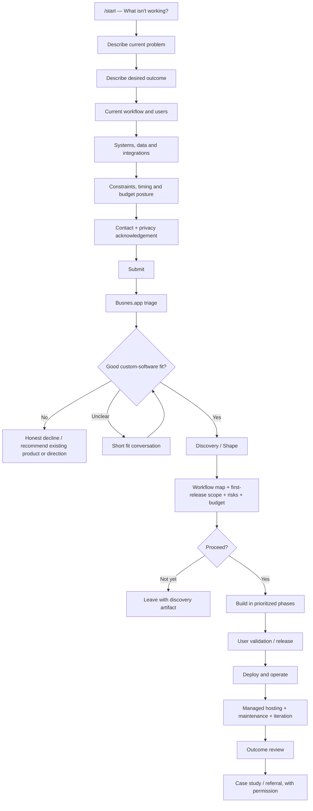

# Busnes.app Website Strategy: Focused Custom Software for Small Businesses

## Executive summary

Busnes.app should not present itself primarily as an “AI development company,” a generic custom-software consultancy, or a catalog of Ky products. The strongest market position is narrower:

> **Busnes.app builds focused, hosted software around the way a small business actually works.**

The customer problem is not “I need an LLM.” It is more often: “We do this in three spreadsheets,” “our software almost works except for this critical part,” “the office has to re-enter the same information twice,” or “I wish customers/employees could just do this themselves.” The website should begin there.

That distinction matters competitively. Pell Software already markets almost the exact economic thesis that AI-assisted engineering can make formerly uneconomic custom business software viable, using reusable templates and AI coding agents. 8th Light likewise leads with AI-era software development while emphasizing that cheaper implementation does not eliminate the risk of building the wrong thing. In other words, **“AI-assisted custom software” is already a competitive category, not a sufficient differentiation.** citeturn16view2turn16view5

Busnes.app's stronger story is therefore:

> **Off-the-shelf software makes your business fit the product. Traditional custom software can be too large an undertaking. Busnes.app builds the smaller, specific application your business actually needs, then hosts and maintains it.**

LLMs belong one level below that promise. They are part of how Busnes.app can make the economics work, not what the customer is buying.

The site should have one dominant conversion goal: **get a person with a real workflow problem into `/start`**, where they can describe what is wrong without first writing a software specification. Secondary pages should answer the questions that prevent them from doing that: *Can I trust you? Have you built real things? How does this work? Is this going to become a giant consulting project? What happens to my data? Who am I actually working with?*

The recommended information architecture is exactly the small one under consideration: `/`, `/how-it-works`, `/work`, `/ky`, `/about`, and `/start`. Resist the agency-site instinct to add “Services,” “Industries,” “Solutions,” “AI,” “Insights,” and a dozen SEO landing pages before there is evidence they are needed. Current competitors such as SPARK and Pell have much broader service trees; that breadth is useful for mature firms but would undermine Busnes.app's proposition that it deliberately builds focused things. citeturn17view9turn17view10

Ky should occupy a particularly important but subordinate role:

> **Busnes.app** = company, relationship, accountability  
> **Ky** = reusable software foundation  
> **Customer application** = the thing the customer actually receives

That positioning is already supportable by the public code. The Busness.app GitHub organization currently has active repositories for KyYard, KyIdentity, KyVault, KyNotes, KyPost and shared components; `ky-primitives` explicitly describes itself as shared security primitives for the suite and contains common facilities for recovery, OIDC verification, SCIM, TOTP, logging/auditing and related concerns. It would therefore be reasonable to describe Ky as a **shared foundation under active development**, but premature to present it as a mature general-purpose application platform. citeturn21view0turn21view1turn21view2

There is also a concrete launch issue to resolve: the public GitHub organization currently displays **“Busness.app”**, while the brand and domain in this project are **“Busnes.app.”** That discrepancy is small technically but significant for trust, search, and identity. Standardizing public spelling should be an MVP launch requirement. citeturn21view0

The recommended commercial story is equally simple:

| Stage | What the visitor should understand |
|---|---|
| Fit | Tell Busnes.app what is not working; no software specification required. |
| Shape | Turn the workflow into a small first release and understand constraints. |
| Build | Work within an agreed budget/phase and prioritize the valuable workflow first. |
| Run | Busnes.app deploys, monitors, maintains and evolves the application. |

Do **not** invent public dollar amounts before Busnes.app has enough completed engagements to know its repeatable economics. Do explain the *shape* of pricing: fit conversation, fixed-fee discovery if applicable, phased build budget, and recurring hosting/support. Atomic Object provides a useful precedent for explaining that early project estimates are inherently uncertain and using a fixed budget with controlled scope and phased releases rather than pretending an exact specification is knowable at the beginning. citeturn20view2turn20view4

The strategic theme of the whole site should be:

> **Small enough to fit. Serious enough to depend on.**

That sentence need not literally become the tagline, but it is the design test for every page.

## Audience, positioning, goals, and conversion funnel

Busnes.app has an unusual audience problem because the buyer may be highly knowledgeable about **their business** while knowing almost nothing about software development. The site therefore needs to communicate in two layers: plain business language first, technical evidence second.

**The primary audience is the owner/operator or operational decision maker.** This person can explain the exception that causes three hours of manual work every Friday, but probably does not describe the need as “a multi-tenant workflow application with RBAC and accounting API integration.” Buildable's current positioning is instructive: it explicitly begins by learning a client's workflows, systems, constraints and goals, and even features customer testimony about its ability to communicate with non-software people during product definition. citeturn19view3

For this visitor, the page must answer:

> Do you understand what I mean even though I do not know how to specify software?

> Are you going to make this much bigger than it needs to be?

> Will I have somebody to call when it stops working?

> Can this talk to the tools we already have?

> Am I buying a project or creating another permanent technology headache?

A second audience consists of **technical or semi-technical decision makers**: internal IT, a technically inclined owner, an MSP, fractional CTO, or someone brought in to evaluate the proposal. That person will care about authentication, backups, integration boundaries, deployment, data ownership, maintainability, security controls, source availability and exit strategy. The homepage should not make everyone read those details. `/ky`, individual `/work` entries, and an eventually richer security/operations page can satisfy that due diligence.

This produces a useful **message ladder**:

> **Business problem:** “Our software doesn't fit the way we work.”

> **Service promise:** “We build the focused application that does.”

> **Operational promise:** “We host it and keep it working.”

> **Economic explanation:** “We reuse the parts that shouldn't be rebuilt every time and use AI-assisted engineering to reduce repetitive development work.”

> **Technical proof:** “Ky provides common foundations, and you can inspect the work.”

That ordering is crucial. Pell currently puts AI-assisted engineering near the center of its proposition and explains proprietary templates and AI agents as a way to reduce manual engineering work. Busnes.app should acknowledge the same technological change but differentiate by leading with **fit, focus, and ongoing ownership of the result** rather than the development tool. citeturn16view2

**The website's goals should be prioritized rather than treated equally.** First is qualified lead generation. Second is reducing perceived risk enough for the prospect to begin a conversation. Third is proving that Busnes.app actually builds software. Fourth is capturing enough structured requirements to make the first conversation useful. Traffic and SEO are means to those goals rather than goals of their own.

The proposed funnel is:

```text
Search / referral / GitHub / word of mouth
                    │
                    ▼
             BUSNES.APP HOME
                    │
          "This sounds like me"
                    │
        ┌───────────┼───────────┐
        │           │           │
        ▼           ▼           ▼
 How it works      Work       Ky / GitHub
 process + risk    proof       technical proof
        │           │           │
        └───────────┴───────────┘
                    │
                    ▼
              /START
     describe the business problem
                    │
                    ▼
            Busnes.app triage
                    │
          ┌─────────┴─────────┐
          │                   │
       good fit            not a fit
          │                   │
          ▼                   ▼
     discovery            honest answer /
          │               useful direction
          ▼
    phased proposal
          │
          ▼
       build + run
```

The crucial point is that **proof pages are optional reassurance loops, not mandatory steps**. A visitor arriving by strong referral may understand the homepage and go directly to `/start`. A skeptical technical visitor may spend twenty minutes in `/ky` and GitHub first. Both journeys should terminate in the same intake.

Current firms provide useful precedents. Pell tells prospects what happens after submission, including that they will speak with a software expert rather than a salesperson. Atomic similarly describes practitioner-led triage and project discussions rather than a conventional commissioned sales process. Those are particularly appropriate patterns for a founder-led Busnes.app because the smallness of the organization can become a trust signal rather than something the site tries to disguise. citeturn17view9turn20view3

The homepage should consequently have one conspicuous primary CTA everywhere:

> **Tell us what you need**

or, more distinctive:

> **Start with the problem**

A secondary CTA can be:

> **See what we've built**

Avoid **“Book a demo”** because there is no generic product to demonstrate, and avoid **“Contact sales”** because it immediately makes a small founder-led studio sound like an organization with a sales department.

A good-fit statement can do significant qualification work:

> **Busnes.app may be a good fit when:**  
> your current software almost works; a recurring workflow still lives in spreadsheets, email, or manual re-entry; your business has an unusual process worth preserving; several systems need to work together; or a focused internal/customer tool would eliminate repeated work.

And an unusually powerful trust element would be an explicit negative:

> **Sometimes you should buy software instead.**  
> If an existing product already solves the problem well, we'll tell you.

That line signals that Busnes.app's incentive is solving the business problem rather than manufacturing a custom-development engagement.

## Information architecture and page content

The six-page structure is sufficient for launch. The navigation can simply be:

**Work · How it works · Ky · About · Start**

“Start” should be visually distinguished as the action.

The concise sitemap is:

| Path | Primary job | Essential content | Primary CTA |
|---|---|---|---|
| `/` | Identify problem, establish proposition, route visitor | Hero, problem examples, process, selected work, Ky explanation, founder trust, engagement model | **Start with the problem** |
| `/how-it-works` | Reduce uncertainty about an engagement | Fit → shape → build → run, communication, pricing structure, AI policy, hosting/maintenance, FAQ | **Tell us what you need** |
| `/work` | Prove capability | Reference builds, eventual client case studies, screenshots, business problem, constrained scope, technical notes | **Start a project** |
| `/ky` | Explain reusable foundation and provide technical proof | Why Ky exists, shared components, architecture, open-source projects, GitHub | **View the work / Start a project** |
| `/about` | Establish human trust | Founder, philosophy, why Busnes.app exists, personal open-source history, operating principles | **Tell me what's not working** |
| `/start` | Capture problem and qualify opportunity | Guided intake, privacy guidance, next-step expectation | **Send to Busnes.app** |

A `/privacy` page should exist in the footer before the intake form starts receiving real submissions; it does not need to occupy the main navigation. A terms page can be added when the site's actual contracting and service policies are settled.

**The homepage** should function as the entire argument in miniature.

Recommended hero:

> **Software built around your business.**
>
> When off-the-shelf software almost fits, Busnes.app builds the focused application your business actually needs — and hosts and maintains it for you.
>
> **[Start with the problem]**  
> **[See what we've built]**
>
> *You don't need a specification. Tell us what's not working.*

This headline is deliberately not “Custom Software Development Services.” The latter should appear in the title tag and supporting copy for search relevance, but the human-facing H1 should communicate the difference.

Immediately after the hero, recognize actual problems:

> **You probably don't need another platform.**
>
> Maybe the important part of your business is still in a spreadsheet.  
> Maybe your current system does 90% of what you need and makes the remaining 10% miserable.  
> Maybe information gets copied from one system to another because they do not talk.  
> Maybe customers or employees need one simple workflow that nobody sells.
>
> **That last mile is what we build.**

The voice here should resemble the reason 37signals/Basecamp's writing is effective: it describes recognizable everyday pain before talking about the product. Basecamp's current homepage spends substantial copy on the lived experience of work fragmented across apps, email, chats and other systems before explaining its answer. citeturn17view11

Next, a four-step strip:

**Explain → Shape → Build → Run**

> **Explain** — Show us how the work happens today.  
> **Shape** — We find the smallest useful version of the solution.  
> **Build** — We build and test it with the people who will use it.  
> **Run** — We host, maintain and improve it with you.

Then show **two or three proof cards**, not a wall of project logos. Initially these can be explicitly labeled **“Ky project”** or **“reference build”** rather than pretending they are client case studies. The public organization currently shows active work including KyYard, KyPost, KyIdentity, KyVault, KyNotes and shared Ky components, giving Busnes.app enough real material to demonstrate engineering breadth without fabricating customer history. citeturn21view0

A reference-build card should look like:

> **KyYard**  
> *A focused control plane for a container fleet.*
>
> **Problem:** Managing a small fleet should not require adopting an enormous orchestration platform.
>
> **What it demonstrates:** infrastructure management, deployment thinking, operational software.
>
> **[See the project] [View source]**

For future customer work, the case-study template should be oriented around outcomes rather than framework choices:

> **Before** — What did the workflow look like?  
> **Constraint** — What made the problem particular to this company?  
> **First release** — What deliberately made the cut?  
> **Not built** — What was intentionally left out?  
> **After** — What changed?  
> **Proof** — screenshot, measured result, customer statement.  
> **Technical note** — optional deeper section.

“**What we did not build**” is unusually important for this brand. It proves the promise of focused software.

Established studios use case studies heavily as risk reduction. Atomic's current homepage surfaces multiple client products and outcome-oriented testimonials, while thoughtbot leads quickly into a quantified featured case study and backs its consulting reputation with a large body of open-source material and a public playbook. citeturn20view1turn19view1

The homepage's **Ky section** should be brief:

> **We don't rebuild the plumbing every time.**
>
> Ky is the shared foundation behind Busnes.app projects: common pieces for identity, security, recovery, deployment and other things that should not be reinvented for every business.
>
> That lets each customer application spend more of its complexity on the part that actually makes that business different.
>
> **[How Ky works]**

That statement should evolve only as the implementation evolves. The public `ky-primitives` repository already demonstrates shared security/recovery/authentication work, but the site should distinguish existing components from planned capabilities. citeturn21view1turn21view2

Finally, the home page should expose the commercial shape:

> **A project shouldn't begin with a giant contract for a giant system.**
>
> **Fit** — First, determine whether custom software makes sense.  
> **Shape** — Define the workflow and first useful release.  
> **Build** — Work in agreed phases and budgets.  
> **Run** — Hosting and ongoing care become a predictable monthly relationship.

Atomic is unusually transparent that its projects are major investments—currently describing typical projects as three to more than eighteen months and $50,000 to over $1 million—and it separately explains its fixed-budget, controlled-scope approach. Busnes.app should borrow the *transparency* without importing an enterprise-sized pricing identity that may not fit its market. citeturn20view0turn20view2

**`/how-it-works`** should answer everything someone fears about custom software.

The core content should be an expanded Fit → Shape → Build → Run journey, followed by “How money works,” “How AI is used,” “What happens after launch,” “What you own / what Busnes.app operates,” “How changes work,” and “When Busnes.app is not the right answer.”

Recommended engagement model:

| Engagement | Commercial shape | Deliverable |
|---|---|---|
| Fit check | No-charge qualification conversation | Clear yes/no on whether the problem appears suitable |
| Discovery / Shape | Fixed-fee when enough work is required | Workflow map, risks, integrations, first-release scope, budget range |
| Build | Phased budget with prioritized/controlled scope | Working software in usable increments |
| Run | Recurring hosting/support agreement | Deployment, operations, maintenance and agreed support |

The discovery fee and whether it is credited toward a subsequent build are business decisions, not website-design decisions. What matters initially is eliminating the mystery.

**`/work`** should be a proof library rather than a project directory. Three excellent stories are stronger than seventeen repository cards. GitHub links should be a technical proof layer inside those stories. A nontechnical owner should never need to understand a commit graph to trust Busnes.app.

**`/ky`** can become considerably more technical. Start with:

> **The custom part should be the part that's actually custom.**
>
> Ky is the reusable foundation behind Busnes.app applications.

Then show a simple architecture:

```text
┌──────────────── Customer-specific application ────────────────┐
│ workflow │ rules │ screens │ reports │ integrations │ portal │
└─────────────────────────────┬──────────────────────────────────┘
                              │
                       built on common
                              │
┌─────────────────────────────▼──────────────────────────────────┐
│                              Ky                               │
│ identity │ security │ recovery │ common patterns │ operations │
└─────────────────────────────┬──────────────────────────────────┘
                              │
                    deployed and operated
                              │
                         KyYard / hosting
```

Then expose implementation detail, source repositories, development status and architecture notes. Evil Martians demonstrates how effective substantial open-source work can be as technical credibility: its site explicitly makes its open-source portfolio part of the firm's proof rather than treating it as an unrelated hobby. thoughtbot does likewise by elevating open source and its public playbook into its resources and expertise story. citeturn16view4turn19view1

**`/about`** should be first person and honest about scale. It should not manufacture plural-company language where it feels unnatural.

A possible opening:

> **I'm building the kind of software shop I kept wishing existed.**
>
> I'm Matthew. I like software that solves a problem completely without trying to become the platform for every possible problem.
>
> Busnes.app applies that idea to small businesses: understand how the work really happens, build the part that needs to be different, reuse the parts that don't, and stay responsible for the software after it ships.

This is also where the personal Yoshiofthewire history can be useful. The personal projects are evidence of a long habit of making practical software, while Busnes.app/Ky remains the professional product and client-work identity.

## Guided intake and requirements capture

`/start` should be a **requirements conversation disguised as a pleasant form**, not a traditional “Contact us” page.

That design is supported by established form research. Nielsen Norman Group recommends progressive disclosure for long or complex forms so users are shown only what is relevant at the current point. W3C similarly recommends dividing long forms into logical stages, showing progress, clearly labeling controls, and giving understandable completion/error feedback. citeturn17view0turn17view1turn17view2

The opening copy should explicitly remove the burden of specification:

> **What do you wish your software did?**
>
> You don't need to know what kind of app you need, how it should be built, or which technology it should use.
>
> Tell us what happens today, what's frustrating about it, and what you wish happened instead.
>
> **Start with the problem →**
>
> *About a few minutes. You can answer “not sure” when you don't know.*

A good progressive flow is:

| Step | Question | Why Busnes.app needs it |
|---|---|---|
| Problem | **What's happening that you want to change?** | Reveals actual pain |
| Desired state | **What do you wish happened instead?** | Defines outcome rather than requested feature |
| Current workflow | **How do you do it today?** | Finds people, handoffs and workarounds |
| Users | **Who would use the new system?** | Establishes roles and surface area |
| Systems | **What does this need to work with?** | Identifies integrations/data dependencies |
| Constraints | **Anything we absolutely cannot change?** | Finds deadlines, policy, security, legacy dependencies |
| Commercial readiness | **Have you already set a budget or timeline?** | Qualifies without demanding false precision |
| Contact | **Who should we talk with about this?** | Converts |

The first screen should contain **one substantive question**, perhaps:

> **What's happening today that you wish worked differently?**
>
> Examples:
>
> “We enter orders in one system and then type them into another.”
>
> “The spreadsheet works until two people edit it at once.”
>
> “Our scheduling software works except for the way we assign equipment.”
>
> “Customers email us for something they should be able to do themselves.”
>
> `[ Large text area ]`
>
> **Continue**

Do not begin with name, email, company, budget and phone number. Those communicate “lead form.” Beginning with the problem communicates “we are already trying to understand.”

A later current-workflow screen could say:

> **How does this work today?**
>
> Walk us through it like you're explaining it to a new employee.
>
> Who starts it? What happens next? Where does information come from? Where does it end up?
>
> `[ Text area ]`
>
> **What tools are involved?**  
> `[ ] Spreadsheet` `[ ] Email` `[ ] Existing business software`  
> `[ ] Accounting system` `[ ] Paper` `[ ] Something else`

The budget question should avoid forcing an invented number:

> **Have you already set aside a budget for this?**
>
> ○ Yes, roughly  
> ○ We know what the problem costs us, but not what software should cost  
> ○ We need help understanding the likely range  
> ○ Not yet
>
> If **Yes**:
>
> **About what range are you planning around?**  
> `[ optional amount/range ]`

Specific standardized budget bands can be added once real inquiry data reveals meaningful breakpoints.

The final step:

> **Where should we send the response?**
>
> Name  
> Business / organization  
> Email  
> Phone *(optional)*
>
> **Anything else before you send this?** *(optional)*
>
> `[ Send to Busnes.app ]`
>
> **What happens next:** We'll review the problem first. If it looks like something we can help with, we'll suggest a conversation. If it doesn't, we'll say so rather than trying to turn it into a project.

This is stronger than simply promising a sales call. Pell's current form is notable for explicitly describing its next steps—response, direct conversation with a software expert, and willingness to point people elsewhere when the fit is wrong. Busnes.app can adopt the principle while expressing it in its own voice. citeturn17view9

**Data capture should be deliberately divided between project information and analytics information.**

The actual submission record can contain the answers above plus timestamp, originating page, UTM parameters when present, referring source, and an internal lifecycle state such as `new`, `reviewing`, `fit`, `discovery`, `proposal`, `won`, `not_fit`. Do not copy free-text business descriptions, names, email addresses, or company names into the analytics system. Analytics should know that `intake_submit_success` occurred, not what the prospect wrote.

The intake should also actively prevent oversharing:

> **Please don't send passwords, customer records, health or financial records, API keys, or other sensitive data here. We only need enough information to understand the problem. If we need examples later, we'll arrange a safer way to share them.**

That is more than good UX. FTC business guidance explicitly advises collecting only data for which there is a legitimate business need, protecting what is retained, and disposing of information once that need ends. citeturn18search0turn18search2turn18search6

A suitable proposed privacy statement for the form is:

> **Your project description is private business information. We use it to evaluate and respond to your request. We do not use your submission for advertising.**

And, if Busnes.app can actually enforce this operational policy:

> **We do not automatically send intake submissions to third-party AI models.**

That second sentence is strategically valuable for a company that openly uses LLM-assisted engineering. Prospects may put unusually sensitive business-process details into `/start`. The site should distinguish **“we use AI in our engineering process”** from **“your confidential submission is model input.”**

A later version could offer explicit consent to AI-assisted summarization or requirements extraction, but that is a poor MVP tradeoff. First prove that the human intake process converts.

The full pipeline should be:



The central design principle is that `/start` captures **enough to decide what conversation to have**, not enough to build the software. Trying to elicit a complete specification from a prospect would merely move expensive discovery work into an unpleasant form.

## Visual and UX system

Busnes.app should look like a **toolmaker that understands businesses**, not an “AI startup” and not a conventional agency.

The visual vocabulary should communicate restraint, specificity and confidence:

**Typography:** one highly readable sans-serif family for normal content; a restrained monospaced face can be used for small technical labels such as `BUSNES.APP / KY`, paths, architecture labels and project metadata. Mono should signal engineering provenance, not make the whole site look like a terminal.

**Layout:** generous spacing, short line lengths, obvious headings, visible borders/boxes where they convey structure, and little decorative chrome. Pages should look designed but not “marketed at.”

**Imagery:** actual screenshots, cropped product interfaces, workflow diagrams, annotated architecture, before/after process graphics, and a real founder photograph. These provide evidence. Generic stock people looking at laptops do not.

**Motion:** minimal. A workflow arrow or subtle state transition may help explanation; animated particle fields and glowing AI networks would make the site less distinctive.

**Tone:** direct, calm and specific. Avoid “revolutionize,” “transform your digital future,” “cutting-edge AI-powered solutions,” “unlock innovation,” and other vocabulary that could be pasted onto any consultancy site.

8th Light is a useful contemporary reference precisely because its AI-era message is skeptical of hype: its current site emphasizes discovering the right thing before exploiting the fact that AI makes implementation cheaper. That is directionally much closer to Busnes.app than presenting model logos or agent animations as the product. citeturn16view5

**Homepage wireframe**

<svg xmlns="http://www.w3.org/2000/svg" viewBox="0 0 1000 900" width="100%" role="img" aria-label="Wireframe of proposed Busnes.app homepage">
  <rect x="20" y="20" width="960" height="860" rx="8" fill="none" stroke="currentColor" stroke-width="2"/>
  <text x="55" y="60" fill="currentColor" font-size="22" font-family="sans-serif" font-weight="700">BUSNES.APP</text>
  <text x="560" y="60" fill="currentColor" font-size="15" font-family="sans-serif">Work   How it works   Ky   About</text>
  <rect x="855" y="38" width="90" height="32" rx="4" fill="none" stroke="currentColor"/>
  <text x="879" y="59" fill="currentColor" font-size="13" font-family="sans-serif">Start</text>

  <rect x="55" y="105" width="890" height="220" rx="6" fill="none" stroke="currentColor"/>
  <text x="85" y="155" fill="currentColor" font-size="34" font-family="sans-serif" font-weight="700">Software built around</text>
  <text x="85" y="196" fill="currentColor" font-size="34" font-family="sans-serif" font-weight="700">your business.</text>
  <text x="85" y="235" fill="currentColor" font-size="16" font-family="sans-serif">Focused applications for the workflows</text>
  <text x="85" y="258" fill="currentColor" font-size="16" font-family="sans-serif">off-the-shelf software doesn't quite fit.</text>
  <rect x="85" y="282" width="165" height="30" rx="4" fill="none" stroke="currentColor"/>
  <text x="102" y="302" fill="currentColor" font-size="13" font-family="sans-serif">Start with the problem</text>
  <text x="280" y="302" fill="currentColor" font-size="13" font-family="sans-serif">See what we've built →</text>

  <text x="55" y="370" fill="currentColor" font-size="22" font-family="sans-serif" font-weight="700">Does this sound familiar?</text>
  <rect x="55" y="390" width="280" height="100" rx="5" fill="none" stroke="currentColor"/>
  <rect x="360" y="390" width="280" height="100" rx="5" fill="none" stroke="currentColor"/>
  <rect x="665" y="390" width="280" height="100" rx="5" fill="none" stroke="currentColor"/>
  <text x="75" y="425" fill="currentColor" font-size="14" font-family="sans-serif">“We keep re-entering</text>
  <text x="75" y="447" fill="currentColor" font-size="14" font-family="sans-serif">the same information.”</text>
  <text x="380" y="425" fill="currentColor" font-size="14" font-family="sans-serif">“Our software almost</text>
  <text x="380" y="447" fill="currentColor" font-size="14" font-family="sans-serif">does what we need.”</text>
  <text x="685" y="425" fill="currentColor" font-size="14" font-family="sans-serif">“This spreadsheet became</text>
  <text x="685" y="447" fill="currentColor" font-size="14" font-family="sans-serif">a business system.”</text>

  <text x="55" y="535" fill="currentColor" font-size="22" font-family="sans-serif" font-weight="700">Explain → Shape → Build → Run</text>
  <line x1="55" y1="555" x2="945" y2="555" stroke="currentColor"/>
  <circle cx="110" cy="585" r="12" fill="none" stroke="currentColor"/>
  <circle cx="360" cy="585" r="12" fill="none" stroke="currentColor"/>
  <circle cx="610" cy="585" r="12" fill="none" stroke="currentColor"/>
  <circle cx="860" cy="585" r="12" fill="none" stroke="currentColor"/>
  <line x1="122" y1="585" x2="348" y2="585" stroke="currentColor"/>
  <line x1="372" y1="585" x2="598" y2="585" stroke="currentColor"/>
  <line x1="622" y1="585" x2="848" y2="585" stroke="currentColor"/>

  <text x="55" y="650" fill="currentColor" font-size="22" font-family="sans-serif" font-weight="700">Proof, not promises</text>
  <rect x="55" y="670" width="430" height="105" rx="5" fill="none" stroke="currentColor"/>
  <rect x="515" y="670" width="430" height="105" rx="5" fill="none" stroke="currentColor"/>
  <text x="75" y="704" fill="currentColor" font-size="17" font-family="sans-serif" font-weight="700">KyYard</text>
  <text x="75" y="730" fill="currentColor" font-size="13" font-family="sans-serif">Problem → focused solution → source</text>
  <text x="535" y="704" fill="currentColor" font-size="17" font-family="sans-serif" font-weight="700">Customer / reference project</text>
  <text x="535" y="730" fill="currentColor" font-size="13" font-family="sans-serif">Before → scope → result → evidence</text>

  <rect x="55" y="805" width="890" height="48" rx="5" fill="none" stroke="currentColor"/>
  <text x="75" y="835" fill="currentColor" font-size="15" font-family="sans-serif">Built on Ky. Hosted and maintained by Busnes.app.                    Start with the problem →</text>
</svg>

The important visual sequence is **recognition → explanation → proof → conversion**. A large animated hero is unnecessary.

**`/start` wireframe**

<svg xmlns="http://www.w3.org/2000/svg" viewBox="0 0 1000 590" width="100%" role="img" aria-label="Wireframe of proposed Busnes.app guided start form">
  <rect x="40" y="25" width="920" height="535" rx="8" fill="none" stroke="currentColor" stroke-width="2"/>
  <text x="75" y="70" fill="currentColor" font-size="20" font-family="sans-serif" font-weight="700">BUSNES.APP / START</text>

  <text x="770" y="68" fill="currentColor" font-size="13" font-family="sans-serif">Step 1 of 6</text>
  <line x1="75" y1="92" x2="925" y2="92" stroke="currentColor"/>
  <line x1="75" y1="92" x2="215" y2="92" stroke="currentColor" stroke-width="5"/>

  <text x="160" y="160" fill="currentColor" font-size="30" font-family="sans-serif" font-weight="700">What's happening today that</text>
  <text x="160" y="198" fill="currentColor" font-size="30" font-family="sans-serif" font-weight="700">you wish worked differently?</text>

  <text x="160" y="237" fill="currentColor" font-size="15" font-family="sans-serif">Explain it like you would to a coworker. You don't need technical terminology.</text>

  <rect x="160" y="270" width="680" height="155" rx="5" fill="none" stroke="currentColor"/>
  <text x="180" y="300" fill="currentColor" font-size="13" font-family="sans-serif">Example: “We get requests by email, copy them into a spreadsheet,</text>
  <text x="180" y="323" fill="currentColor" font-size="13" font-family="sans-serif">then somebody has to enter the same details into our accounting system...”</text>

  <text x="160" y="458" fill="currentColor" font-size="12" font-family="sans-serif">Please don't include passwords, customer records, API keys, or other sensitive data.</text>

  <rect x="690" y="485" width="150" height="38" rx="4" fill="none" stroke="currentColor"/>
  <text x="738" y="509" fill="currentColor" font-size="14" font-family="sans-serif">Continue →</text>
</svg>

Accessibility should be designed into this instead of added afterward. W3C's current form guidance specifically emphasizes explicit labels/instructions, logical multi-page stages, progress indication and actionable error feedback. Those requirements fit the proposed quiet, straightforward visual system naturally. citeturn17view1turn17view2

## SEO, technical architecture, security, and measurement

**SEO strategy**

The homepage should optimize semantically for the problem category while retaining the stronger human headline.

A reasonable initial keyword vocabulary—not a claim about search volume—would be:

`custom software for small business` · `custom business software` · `custom business applications` · `custom internal tools` · `business workflow software` · `workflow automation software` · `software to replace spreadsheets` · `custom web application development`

The title and H1 can therefore have different jobs:

> **Title:** Custom Software for Small Businesses | Busnes.app

> **H1:** Software built around your business.

> **Meta description:** Busnes.app builds focused, hosted custom applications for small businesses whose workflows do not quite fit off-the-shelf software.

That approach follows Google's current guidance to use language people actually use to find a page in prominent elements such as the title and primary heading, while focusing content on helpfulness for the user rather than search-engine manipulation. citeturn17view6

A useful content map is:

| Page | Search/message territory |
|---|---|
| `/` | custom software for small businesses; custom business software |
| `/how-it-works` | custom software process; build vs. buy; hosted custom applications |
| `/work` | specific problems and use cases demonstrated by actual work |
| `/ky` | Ky platform; reusable application foundation; open-source technical proof |
| `/about` | Busnes.app brand/founder |
| Future evidence-driven pages | replace spreadsheets; custom workflow app; business-system integration; customer portal, etc. |

Do not launch dozens of generic “Custom Software for Dentists,” “Custom Software for Plumbers,” and “Custom Software for [City]” pages without actual expertise or evidence. Google's guidance emphasizes people-first, non-commodity content and explicitly warns against scaled material designed primarily to manipulate search visibility. citeturn16view7turn17view6

The best future SEO assets will likely be practical pages born from real sales conversations:

> **When should a small business build custom software instead of buying SaaS?**

> **When has a spreadsheet become a business-critical application?**

> **How to scope a custom internal tool without writing a 50-page specification**

> **What happens to custom software after it launches?**

Those simultaneously answer buyer objections and create useful search material.

Add `Organization` structured data to the homepage. Google says organization markup can help it understand and disambiguate an organization and can supply details such as the logo used in search-related contexts. citeturn17view7

As of September 2026, Google also explicitly says normal SEO fundamentals continue to apply to its generative-AI search features; it says there is no requirement for `llms.txt`, special AI markup, artificial content “chunking,” or separate rewriting for AI systems. Busnes.app therefore should not spend MVP effort on speculative “GEO” tricks at the expense of excellent crawlable project pages and useful business content. citeturn16view7

**Technical architecture**

The recommended architecture is **mostly static, selectively dynamic**.

All six public pages should be pre-rendered HTML wherever practical. The only essential dynamic application at launch is the `/start` submission path. That keeps the marketing surface small and allows the site's technology to reflect its own philosophy: custom complexity only where it buys something.

No particular framework is required. An SSG, server-rendered application with aggressive static output, or hand-built templates could all satisfy the architecture. The requirement should be:

```text
                    Internet
                       │
             Cloudflare DNS / edge
                       │
        ┌──────────────┴──────────────┐
        │                             │
        ▼                             ▼
  Static public site             /start endpoint
  /                              validation
  /work                          rate limits
  /ky                            anti-bot
  /about                         submission storage
  /how-it-works                  notification
        │                             │
        └──────────────┬──────────────┘
                       │
                  KyYard-managed
                 deployment target
                       │
              logs / backups / ops
```

Given the user's existing Cloudflare-managed domains, using Cloudflare at the DNS/edge layer is a natural option. Turnstile is also a sensible form-defense candidate: Cloudflare describes it as a challenge system designed to distinguish humans from automated traffic while not reading or storing the actual form entries, and its managed widget is the recommended mode in its current documentation. citeturn17view4

For KyYard, the right goal is **dogfooding without making the sales website dependent on unfinished platform functionality**. The public KyYard repository currently describes the project as a control plane for a container fleet. Package the site and intake service so they are easy to deploy and operate through KyYard as those capabilities mature, but maintain an escape route to ordinary container hosting. citeturn21view0

A clean initial runtime might consist of:

```text
busnes-web       pre-rendered site / static server
busnes-intake    small submission API
submission-db    encrypted lead/project-intake storage
umami            optional first-party analytics
```

The database choice is intentionally unspecified; expected load does not justify letting the marketing site dictate a broader infrastructure stack.

**Security and privacy**

The MVP intake endpoint should enforce server-side input limits and validation, encode any submitted content before redisplay, use anti-automation controls and rate limiting, and apply appropriate cross-site request protections if authenticated or cookie-based state is introduced. OWASP's current guidance treats CSRF, XSS and other web input/output risks as core web-application concerns rather than something client-side controls alone can solve. citeturn15search2turn15search10turn15search29

Do not support attachments at launch. A prospect does not need to upload a database export, financial report or customer list to establish whether there is a fit. Secure document exchange can be introduced after a relationship exists.

The submission notification sent to you should ideally say **“New Busnes.app intake received”** and link to the protected record rather than copying the full confidential business description into email. That reduces unnecessary copies.

Adopt and publish a retention policy: keep rejected or dormant inquiries only as long as Busnes.app has a genuine business reason to retain them, and provide a deletion route. FTC guidance explicitly recommends minimizing collection, limiting retention to legitimate business need, protecting retained data, and securely disposing of data no longer needed. citeturn18search0turn18search13

**Analytics**

For this particular brand, an enormous marketing surveillance stack would be incongruous.

Umami is a good conceptual fit if self-hosting is desirable: its current documentation describes it as open-source, privacy-focused and self-hostable. Plausible is another option and explicitly supports custom events for actions such as button clicks and conversions. citeturn16view6turn17view5

GA4 can be introduced later if paid acquisition creates a strong need for Google's advertising attribution ecosystem. It need not be an MVP default.

Recommended event taxonomy:

| Event | Trigger | Properties that are safe/useful | Decision it supports |
|---|---|---|---|
| `hero_start_click` | Primary homepage CTA | `page`, `referrer_group` | Is proposition creating intent? |
| `work_open` | Opens project/case study | `work_id` | Which proof matters? |
| `github_click` | Leaves for source | `project_id`, `source_page` | Does technical proof attract prospects? |
| `ky_open` | Navigates to `/ky` | `source_page` | How often do visitors seek technical depth? |
| `how_it_works_open` | Opens process page | `source_page` | Is process reassurance part of conversion? |
| `intake_begin` | Starts `/start` flow | `source_page` | Visitor → lead intent |
| `intake_step_complete` | Advances a form step | `step_name` | Where is friction? |
| `intake_submit_success` | Submission accepted | `source_page`, non-PII campaign tags | Core conversion |
| `intake_submit_error` | Technical submission failure | `error_class`, never entered data | Reliability |
| `case_study_start_click` | CTA from work item | `work_id` | Proof-assisted conversion |

Do **not** send `name`, `email`, `company`, problem descriptions, desired outcomes, integration names when uniquely identifying, or other form text as analytics properties.

Analytics events are not the business metrics themselves. The operating dashboard should concentrate on:

| Metric | Definition |
|---|---|
| Start rate | `intake_begin ÷ relevant site visitors` |
| Intake completion | `successful submissions ÷ intake begins` |
| Qualified inquiry rate | manually qualified submissions ÷ submissions |
| Discovery conversion | prospects entering discovery ÷ qualified inquiries |
| Project conversion | signed engagements ÷ qualified inquiries |
| Proof-assisted inquiry rate | inquiries that interacted with `/work`, `/ky`, or GitHub before submission |
| Median first-response time | submission → first human response |
| Lead source quality | qualified/signed work by referral, search, GitHub, direct, campaigns |
| Deployment reliability | site/intake availability and submission-error count |

Do not begin by declaring generic “industry benchmark” conversion goals. Establish Busnes.app's own baseline, then optimize the stages that actually lose qualified people. A site receiving twenty highly relevant referrals has a different funnel from one receiving thousands of generic search visits.

## Roadmap, launch scope, and sites to learn from

The site should grow in three stages.

**Launch stage:** ship the complete six-page narrative, honest project proof, secure guided intake, analytics and production operations. The primary objective is to learn whether prospects understand the proposition and whether `/start` produces intelligible, qualified conversations.

**Evidence stage:** replace generic assertions with real customer evidence. Add case studies with before/after outcomes, testimonials, more precise engagement ranges, FAQs derived from objections, and a small number of useful search pages based on actual inquiry patterns. SPARK's current planning survey and ROI resources illustrate the kind of content that can become valuable once there is enough sales experience to know what prospects repeatedly need help answering. citeturn17view10

**Platform stage:** let the website itself become a front end to the Busnes.app software-production process. Structured intake could produce internal workflow maps, project briefs and discovery artifacts; returning customers could have a portal; proposals and requirements could flow into project tooling; an explicitly disclosed LLM step could summarize requirements. Those should be downstream operational improvements, not features that delay learning from the first real customers.

The **launch MVP checklist** should be limited to these eight items:

- **Brand consistency:** resolve `Busnes.app` versus the current public `Busness.app` GitHub identity, and standardize wordmark, organization name, email identity and public metadata. citeturn21view0
- **Complete six-page narrative:** `/`, `/how-it-works`, `/work`, `/ky`, `/about`, `/start`, each with one obvious path toward `/start`.
- **Credible proof:** at least two strong reference-build stories with real screenshots/artifacts and accurately labeled status; no invented client outcomes.
- **Working guided intake:** progressive flow, success/error handling, confirmation page, internal triage notification and tested mobile behavior. W3C and NN/G guidance support the staged form approach. citeturn17view0turn17view1
- **Trust and privacy foundation:** real founder identity, clear next steps, `/privacy`, data-minimization guidance, retention policy and anti-bot/input protections. citeturn18search0turn17view4
- **Search/accessibility/performance basics:** unique titles, useful headings, crawlable HTML, Organization schema, Search Console verification, labeled accessible forms and strong mobile performance. citeturn17view6turn17view7turn16view7
- **Measurement:** privacy-respecting analytics plus the event taxonomy above; a simple internal lead state so “traffic” can eventually be connected to qualified work.
- **Operational runbook:** repeatable deploy, rollback, backup, monitoring, intake-delivery test and recovery procedure, ideally dogfooded through KyYard without making launch depend on experimental capabilities.

Eight current sites are especially useful references, but each should be studied for a different reason rather than copied wholesale:

| Reference | What Busnes.app should study | What not to copy |
|---|---|---|
| [Pell Software](https://www.pellsoftware.com/) | Closest direct competitive framing: custom business apps, operational problems, direct expert contact, support; its AI-development material also proves that “AI-assisted custom software” is already occupied territory. citeturn17view9turn16view2 | Its broad “one-stop shop” service catalog and AI-first positioning would make Busnes.app less distinctive. |
| [Atomic Object](https://atomicobject.com/) | Excellent case-study architecture, frank discussion of custom-software investment, practitioner-led sales and fixed-budget/controlled-scope reasoning. citeturn20view0turn20view2 | Enterprise-scale tone and project economics should not be imported without evidence they fit Busnes.app's customers. |
| [Buildable](https://www.buildableworks.com/) | Plain explanation that good software begins by understanding workflows, systems, constraints and goals; especially relevant for nontechnical stakeholders. citeturn19view3 | The broad industry/service catalog. |
| [thoughtbot](https://thoughtbot.com/) | Integration of client case studies, deep educational material, open-source work and a published playbook into one trust system. citeturn19view1 | Its audience and service breadth are much larger than the focused Busnes.app MVP needs. |
| [Evil Martians](https://evilmartians.com/) | Treating open source as first-class evidence of engineering competence and being unusually concrete about expertise and engagement economics. citeturn16view4 | Developer-first language on the customer-facing homepage; Busnes.app's primary buyer often will not be an engineer. |
| [8th Light](https://8thlight.com/) | Excellent AI-era positioning principle: faster/cheaper implementation does not remove the need to discover the right thing to build. citeturn16view5 | Leading Busnes.app with “AI” before it has established the business problem. |
| [SPARK Business Works](https://sparkbusinessworks.com/) | Small-business-operational vocabulary, planning resources, ROI framing and guided planning tools that could inspire later-stage content. citeturn17view10 | Its extensive service/industry IA; Busnes.app should stay much smaller initially. |
| [Basecamp / 37signals](https://basecamp.com/) | Conversational, pain-first writing that describes the reader's day before describing software; restraint and opinionated product language. citeturn17view11 | The product-company business model itself; the useful reference here is voice, not structure. |

The competitive research leads to an important final conclusion. There is already no shortage of companies saying **“we build custom software,” “we understand your workflows,” “we use AI,”** or **“we automate your business.”** Pell, Buildable, SPARK, Atomic, 8th Light and others all occupy combinations of those claims today. citeturn16view2turn19view3turn17view10turn20view0turn16view5

Busnes.app therefore should not attempt to win by finding a clever synonym for “custom software development.” It should make the *shape of the practice* distinctive:

> # Software built around your business.
>
> **Not a product for everybody. The application your business actually needs.**
>
> Tell us what's not working. We'll understand the workflow, find the smallest useful solution, build it on a reusable foundation, and keep it running.
>
> **[Start with the problem]**

And one level deeper:

> **Built on Ky.**
>
> The parts that make your business different should be custom.  
> The plumbing shouldn't be.

That relationship—**Busnes.app as accountable studio, Ky as reusable foundation, and each client application as intentionally focused software**—is broad enough to support the long-term vision while being concrete enough for a small-business owner to understand today.